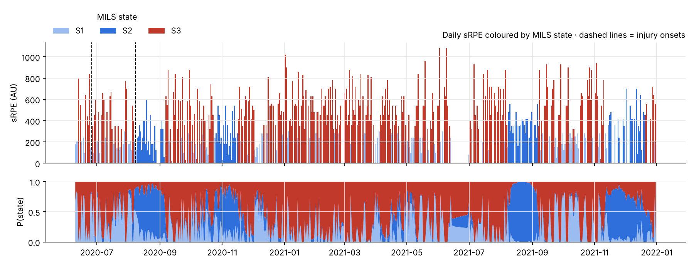

# football-load-injury

[](https://github.com/Clement0242/football-load-injury/actions/workflows/tests.yml)

**Load states, heart rate × GPS, and injuries in elite women's football.**
Two seasons of the open SoccerMon dataset: questionnaires, GNSS and heart rate,
aligned day by day.

🌐 **Report:** https://clement0242.github.io/football-load-injury/

*Version française plus bas.*



## Questions

1. **Do internal and external load agree?** The questionnaire (sRPE), heart
   rate (Edwards TRIMP), distance and accelerometer load are compared with
   *repeated-measures* correlations, which look within each player.
2. **What does the cardiac cost of running say?** Heart rate at 2 m/s, from
   a regression on 30-second epochs in each session, is followed over the
   season and compared with the morning's wellness.
3. **What are the hidden load states?** MILS (Markov Index Load State, by
   Q. De Larochelambert and K. Barlier, INSEP) fits a hidden Markov model to
   each player's z-scored daily load, with rest days treated as missing.
4. **Does anything warn of an injury?** REDI acute:chronic ratio, MILS
   high-load state and wellness are scored by their *within-player* AUC for
   an injury in the next 7 days.

## What is in it

| | |
|---|---|
| `src/charge/mils.py` | MILS reimplemented in Python. Preparation identical to the R package (missing days, rest = missing, trimming, z-score per athlete). Gaussian HMM fitted by EM over all athletes, states sorted by load, forward-backward posteriors. Compiled with numba. REDI and EWMA from the same package. |
| `src/charge/stats.py` | Repeated-measures correlation, Cohen's κ, within-player AUC with a player bootstrap, leave-one-player-out logistic model |
| `analysis/run_analysis.py` | Every figure and number, written to `docs/results.json` |
| `analysis/build_report.py` | The report page, generated from `results.json` |

**Tests:**

* The EM matches `hmmlearn` on complete data.
* Simulated states are recovered with 20 % missing days.
* REDI matches the R formula.
* Repeated-measures correlation ignores between-player offsets.
* The within-player AUC is not fooled by them.

## A methodological note

A pooled AUC under leave-one-player-out cross-validation came out far
*below* 0.5 here, which is impossible for a useless indicator. It happens
because each held-out player is predicted by a model fitted on a different
base rate, which creates an artificial anti-correlation between players. The
evaluation therefore compares each player's pre-injury days with her own other
days (within-player AUC). That is also the question a staff actually asks.

## Data

The inputs are the governed marts of
[athlete-data-governance](https://github.com/Clement0242/athlete-data-governance),
a dbt warehouse whose quality rules found frozen heart-rate sensors, missing
sessions and twice-pseudonymised players before this analysis ran.

```bash
pip install -e .
python analysis/run_analysis.py --marts https://raw.githubusercontent.com/Clement0242/athlete-data-governance/main/data/marts
python analysis/build_report.py
```

SoccerMon: Midoglu C. et al. (2024), *Scientific Data* 11, 553, CC-BY 4.0.
MILS: https://github.com/quentincad2/MILS, GPL-3, so this repository is GPL-3 too.

---

## En français

Deux saisons d'une équipe féminine élite (SoccerMon) : questionnaires, GPS et
fréquence cardiaque alignés jour par jour.

* **Couplage FC × GPS :** des corrélations intra-joueuse entre la charge
  ressentie (sRPE), la charge cardiaque (TRIMP), la distance et
  l'accéléromètre, et le coût cardiaque d'une même vitesse de course
  (fréquence cardiaque à 2 m/s) au fil de la saison.
* **États de charge MILS**, réimplémentés en Python et validés contre
  `hmmlearn`. Le modèle d'origine est de Quentin De Larochelambert et Kilian
  Barlier (INSEP).
* **Blessures :** le ratio REDI aigu/chronique, l'état de charge haute et le
  wellness sont évalués par une AUC intra-joueuse. Aucun indicateur ne
  prévient de façon fiable d'une blessure pour une joueuse donnée : ce
  résultat honnête rejoint la littérature.

Auteur : [Clément Verdier](https://clement0242.github.io). Licence GPL-3.
